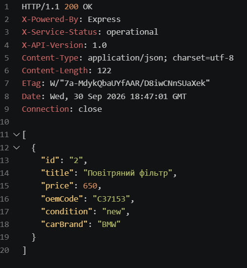
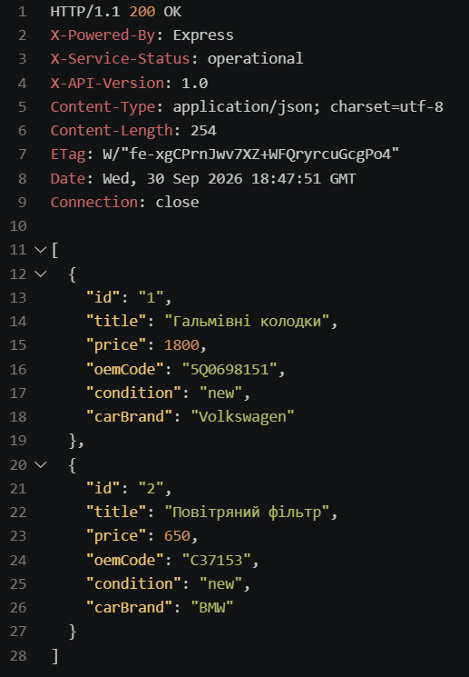
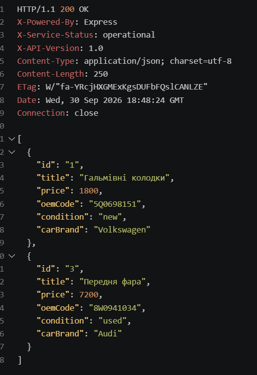
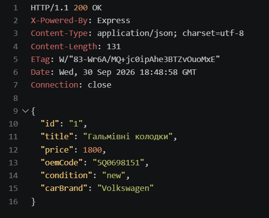
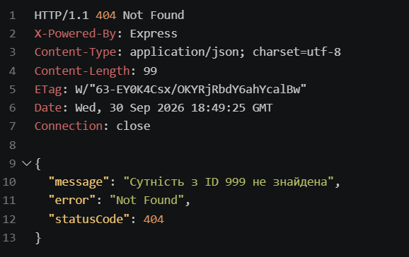
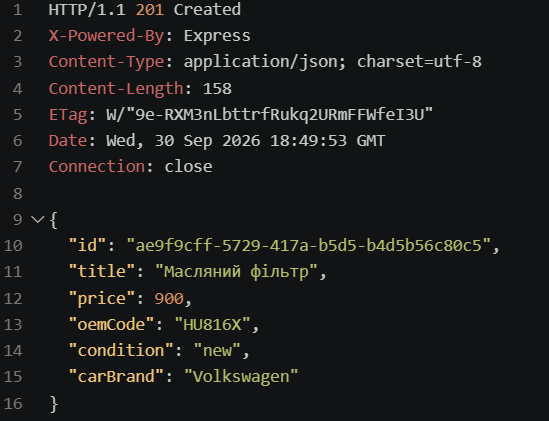
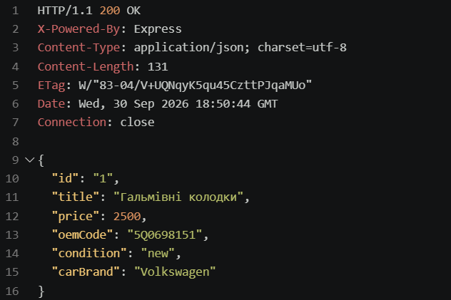
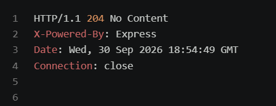

# NestJS REST API — Auto Parts

## Опис

Практична робота з розробки REST API на **NestJS**.

У межах роботи реалізовано REST API для роботи з автозапчастинами. Дані зберігаються в пам'яті програми у вигляді масиву об'єктів.

### Варіант 7 — Auto Parts

Сутність автозапчастини містить такі поля:

- `id` — унікальний ідентифікатор;
- `title` — назва автозапчастини;
- `price` — ціна;
- `oemCode` — OEM-код;
- `condition` — стан запчастини;
- `carBrand` — марка автомобіля.

---

## Використані технології

- Node.js
- TypeScript
- NestJS
- REST API
- REST Client для Visual Studio Code

---

## Структура проєкту

```text
src/
├── auto-parts/
│   ├── dto/
│   │   ├── create-auto-part.dto.ts
│   │   └── update-auto-part.dto.ts
│   ├── auto-part.entity.ts
│   ├── auto-parts.controller.ts
│   └── auto-parts.service.ts
├── app.controller.ts
├── app.service.ts
├── app.module.ts
└── main.ts

requests.http
```

---

## DTO

Для створення автозапчастини використовується `CreateAutoPartDto`:

```ts
export class CreateAutoPartDto {
  title: string;
  price: number;
  oemCode: string;
  condition: string;
  carBrand: string;
}
```

Для оновлення використовується `UpdateAutoPartDto`, у якому всі поля є необов'язковими:

```ts
export class UpdateAutoPartDto {
  title?: string;
  price?: number;
  oemCode?: string;
  condition?: string;
  carBrand?: string;
}
```

---

## REST endpoints

Базовий маршрут:

```text
/auto-parts
```

| Метод | Endpoint | Опис |
|---|---|---|
| GET | `/auto-parts` | Отримати всі автозапчастини |
| GET | `/auto-parts/:id` | Отримати автозапчастину за ID |
| POST | `/auto-parts` | Створити автозапчастину |
| PATCH | `/auto-parts/:id` | Оновити автозапчастину |
| DELETE | `/auto-parts/:id` | Видалити автозапчастину |

---

## GET — отримання всіх автозапчастин

```http
GET http://localhost:3000/auto-parts
```

Повертає список усіх автозапчастин.

### Скріншот


---

## GET — пошук

Для пошуку використовується query-параметр `search`.

```http
GET http://localhost:3000/auto-parts?search=фільтр
```

Пошук виконується за назвою автозапчастини.

### Скріншот



---

## GET — обмеження кількості результатів

Для обмеження кількості результатів використовується параметр `limit`.

```http
GET http://localhost:3000/auto-parts?limit=2
```

### Скріншот



---

## GET — пошук + limit

Query-параметри можна використовувати одночасно:

```http
GET http://localhost:3000/auto-parts?search=а&limit=2
```

### Скріншот



---

## GET — отримання за ID

```http
GET http://localhost:3000/auto-parts/1
```

Повертає конкретну автозапчастину.

### Скріншот



---

## Обробка помилок

Якщо автозапчастини з таким ID не існує, сервер повертає HTTP `404 Not Found`.

```http
GET http://localhost:3000/auto-parts/999
```

Для цього використовується `NotFoundException`.

### Скріншот



---

## POST — створення автозапчастини

```http
POST http://localhost:3000/auto-parts
Content-Type: application/json

{
  "title": "Масляний фільтр",
  "price": 900,
  "oemCode": "HU816X",
  "condition": "new",
  "carBrand": "Volkswagen"
}
```

При успішному створенні сервер повертає статус:

```text
201 Created
```

ID створюється автоматично за допомогою `randomUUID()`.

### Скріншот



---

## PATCH — оновлення автозапчастини

```http
PATCH http://localhost:3000/auto-parts/1
Content-Type: application/json

{
  "price": 2500
}
```

Можна змінювати як одне поле, так і декілька.

### Скріншот



---

## DELETE — видалення автозапчастини

```http
DELETE http://localhost:3000/auto-parts/3
```

При успішному видаленні сервер повертає:

```text
204 No Content
```

### Скріншот



---

## IoC та Dependency Injection

У проєкті використовується механізм Dependency Injection NestJS.

`AutoPartsService` реєструється як provider:

```ts
@Injectable()
export class AutoPartsService {
}
```

А потім автоматично передається в контролер через конструктор:

```ts
constructor(
  private readonly autoPartService: AutoPartsService,
) {}
```

Таким чином контролер не створює сервіс вручну, а отримує його через контейнер залежностей NestJS.

---

## Controller

`AutoPartsController` відповідає за HTTP-запити:

```ts
@Controller('auto-parts')
export class AutoPartsController {
}
```

У контролері використовуються декоратори:

- `@Get()`
- `@Post()`
- `@Patch()`
- `@Delete()`
- `@Param()`
- `@Query()`
- `@Body()`
- `@Header()`
- `@HttpCode()`

---

## Service

`AutoPartsService` відповідає за роботу з даними.

Дані зберігаються в масиві:

```ts
private items: AutoPart[] = [];
```

Сервіс реалізує операції:

- отримання всіх записів;
- пошук;
- обмеження кількості результатів;
- отримання за ID;
- створення;
- оновлення;
- видалення.

---

## Тестування

Для тестування REST API використовується файл:

```text
requests.http
```

У ньому знаходяться приклади всіх основних HTTP-запитів.

Запити тестувалися за допомогою розширення **REST Client** у Visual Studio Code.

### Приклад

```http
GET http://localhost:3000/auto-parts
```

Для запуску окремого запиту використовується кнопка **Send Request**.

---

## Запуск проєкту

Встановити залежності:

```bash
npm install
```

Запустити проєкт у режимі розробки:

```bash
npm run start:dev
```

Після запуску API доступне за адресою:

```text
http://localhost:3000
```

Основний endpoint:

```text
http://localhost:3000/auto-parts
```

---

## Результат виконання

У результаті роботи створено REST API на NestJS з підтримкою CRUD-операцій для автозапчастин.

Реалізовано:

- модульну структуру NestJS;
- Controller;
- Service Provider;
- Dependency Injection;
- DTO;
- Entity interface;
- CRUD операції;
- пошук через `search`;
- обмеження кількості через `limit`;
- HTTP статуси;
- обробку `404 Not Found`;
- власні HTTP headers;
- тестування REST API через `requests.http`.

---

## Висновок

Під час виконання практичної роботи було отримано практичні навички розробки REST API за допомогою NestJS. Було опрацьовано модульну архітектуру фреймворку, контролери, сервіси, Dependency Injection, DTO, HTTP-методи, параметри запитів, HTTP-заголовки та обробку помилок.